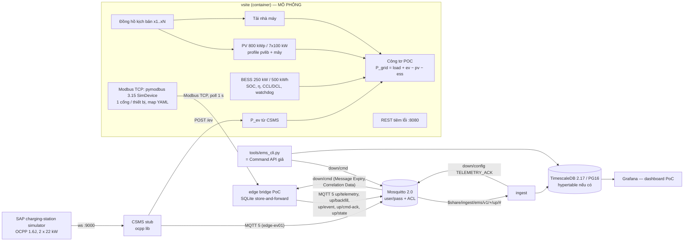

# PoC hạ tầng EMS — virtual site + edge bridge + MQTT 5 + DB

- Ngày: 2026-10-10 · Trạng thái: **PoC chạy được, đã kiểm end-to-end trong container lab** (mục [Kết quả chạy thử](#9-kết-quả-chạy-thử)).
- Đầu vào: [16 Đánh giá simulator](../docs/research/ems/16-simulator-evaluation.md), [E3 nhật ký lab](../docs/research/ems/notes/E3-simulator-handson.md), [15 Mô phỏng và messaging](../docs/research/ems/15-simulators-and-messaging.md), [07 Tích hợp thiết bị](../docs/research/ems/07-device-integration.md) (hợp đồng chuẩn), [05 Mô hình miền](../docs/research/ems/05-domain-model.html) (dấu, đơn vị, quality), [06 Kiến trúc](../docs/research/ems/06-system-architecture.html).
- **Mọi số liệu ở đây là MÔ PHỎNG.** Edge bridge trong repo này là **PoC**, không phải edge production của 06/07 (xem [§12](#12-ánh-xạ-sang-kiến-trúc-production-0607)).

## Mục lục

1. [Mục đích](#1-mục-đích)
2. [Kiến trúc](#2-kiến-trúc)
3. [Thư mục và thành phần](#3-thư-mục-và-thành-phần)
4. [Cách chạy](#4-cách-chạy)
5. [Hợp đồng đã áp dụng (07/15)](#5-hợp-đồng-đã-áp-dụng-0715)
6. [Virtual site: mô hình và register map](#6-virtual-site-mô-hình-và-register-map)
7. [Kịch bản demo (lệnh chính xác)](#7-kịch-bản-demo-lệnh-chính-xác)
8. [Smoke test tự động](#8-smoke-test-tự-động)
9. [Kết quả chạy thử](#9-kết-quả-chạy-thử)
10. [Mô phỏng gì, thật gì](#10-mô-phỏng-gì-thật-gì)
11. [Giấy phép](#11-giấy-phép)
12. [Ánh xạ sang kiến trúc production (06/07)](#12-ánh-xạ-sang-kiến-trúc-production-0607)
13. [Khác biệt với tài liệu và xung đột đã gặp](#13-khác-biệt-với-tài-liệu-và-xung-đột-đã-gặp)
14. [Giới hạn đã biết](#14-giới-hạn-đã-biết)

---

## 1. Mục đích

Chứng minh bằng chạy thật rằng các hợp đồng ở 07/15 khép kín được qua một chuỗi tối thiểu:

thiết bị Modbus ảo (PV SunSpec × 7, BESS/PCS, công tơ POC, công tơ tải) + trạm sạc OCPP 1.6 ảo → edge bridge PoC → **MQTT 5** (Mosquitto) → ingest → **PostgreSQL/TimescaleDB**; và chiều ngược lại: lệnh `SET_ESS_P` có hạn, idempotent, có ack từng bước, readback và hoàn nguyên khi hết hạn/khi edge chết.

Không làm ở PoC này: backend Java, UI sản phẩm, ký JWS, arbiter, vòng điều khiển cục bộ, Protobuf.

## 2. Kiến trúc



Bản ASCII (cho terminal):

```
 SAP sim (OCPP 1.6J) ──ws──► CSMS stub ──POST /ev──┐
                               │ MQTT (edge-ev01)  ▼
 vsite: PV×7 SunSpec │ BESS │ meter POC │ meter tải   (REST :8080 tiêm lỗi)
        └──── Modbus TCP :5021-5027, :5030, :5040, :5041 ────┐
                                                             ▼
                          edge bridge PoC (poll 1 s, cửa sổ C1/C2/C3/C4, SQLite outbox)
                                │ ▲ MQTT 5  ems/v1/edge-vsite01/{up,down}/...
                                ▼ │
                          Mosquitto 2.0.20 ──$share/ingest──► ingest ──► TimescaleDB ──► Grafana
                                ▲            ◄── TELEMETRY_ACK (down/config)
                       tools/ems_cli.py (dispatcher: chỉ được publish down/cmd)
```

## 3. Thư mục và thành phần

| Đường dẫn | Nội dung | Image |
|---|---|---|
| `infra/docker-compose.yml`, `.env.example` | Toàn bộ stack; mật khẩu chỉ trong `.env` (git-ignored) | — |
| `infra/mosquitto/` | `mosquitto.conf` (MQTT 5, không anonymous), `acl.conf` (ACL theo `%u` = `edge_id`), `entrypoint.sh` sinh password file từ biến môi trường | `eclipse-mosquitto:2.0.20` |
| `infra/db/init.sql` | Bảng hẹp `telemetry`, `telemetry_batch`, `command`, `command_ack`, `event`, `edge_state`, view `latest_value`; hypertable **có điều kiện** | `timescale/timescaledb:2.17.2-pg16` |
| `infra/config/site.yaml` | Point mapping theo site (07 §6.3): thiết bị, endpoint, `pid`, `sampling_class`, SOE của BESS — dùng chung cho bridge, ingest, vsite | — |
| `infra/grafana/` | Datasource + 1 dashboard "EMS PoC — Virtual site (MÔ PHỎNG)" | `grafana/grafana-oss:11.3.0` |
| `simulators/vsite/` | Virtual site (Python): `vsite/model.py` (vật lý), `vsite/server.py` (Modbus + tiêm lỗi), `vsite/__main__.py` (REST); `maps/*.yaml` + `maps/regmap.py` (**register map và codec dùng chung với bridge**); `profiles/` (CSV pvlib + script sinh) | `ems-poc/vsite:0.1.0` |
| `simulators/evse/sap/` | Dockerfile build SAP simulator từ commit ghim `3c5b406` (4.12.0), template trạm `ems-ac22` | `ems-poc/evse-sap:4.12.0-3c5b406` |
| `simulators/evse/csms/` | CSMS stub OCPP 1.6J (`ocpp` 2.1.0) → MQTT 5 | `ems-poc/csms-stub:0.1.0` |
| `edge/bridge/` | Edge bridge **PoC**: poller, cửa sổ tổng hợp, outbox SQLite, MQTT 5, xử lý lệnh | `ems-poc/edge-bridge:0.1.0` |
| `ingest/` | MQTT → PostgreSQL, dedupe theo `(edge_id, stream, seq)`, TELEMETRY_ACK | `ems-poc/ingest:0.1.0` |
| `tools/ems_cli.py` | CLI: gửi lệnh, tiêm lỗi, xem giá trị mới nhất, kiểm cân bằng/seq | `ems-poc/tools:0.1.0` (profile `tools`) |
| `tests/smoke.sh` | Smoke test bước 2–4, exit ≠ 0 khi lỗi | — |

Phiên bản Python ghim trong `requirements.txt` của từng thư mục (pymodbus 3.15.0, pysunspec2 1.3.6, aiohttp 3.14.4, PyYAML 6.0.3, paho-mqtt 2.1.0, psycopg[binary] 3.2.10, ocpp 2.1.0, websockets 17.2). Image nền `python:3.12.15-slim`, `node:22-alpine@sha256:0a71…`.

## 4. Cách chạy

```bash
cd infra
cp .env.example .env          # đổi mọi change-me-* thành mật khẩu thật
docker compose up -d --build --wait
docker compose ps             # 8 service: mosquitto, db, vsite, bridge, ingest, csms, evse, grafana
```

- Lần build đầu ~2–5 phút (SAP simulator build bằng pnpm). Sau đó ~20 s để mọi service `healthy`.
- Proxy TLS chặn giữa (như lab này): đặt `BUILD_CA_FILE=/đường/dẫn/ca.crt` trong `.env`; file chỉ được mount làm BuildKit secret lúc build, không nằm trong image.
- Docker Hub có thể trả **429**: chạy lại `docker compose pull`/`build` sau 30–60 s (lab đã gặp với TimescaleDB, thử lại có backoff thì được).
- Cổng chỉ mở trên `127.0.0.1`: MQTT 1883, PostgreSQL 5432, vsite REST 8080 (+ Modbus 5030 BESS, 5040 công tơ POC để thử tay), Grafana 3000 (`admin` / `GRAFANA_ADMIN_PASSWORD`).
- CLI: `docker compose --profile tools run --rm tools <lệnh>` (gợi ý `alias ems='docker compose --profile tools run --rm -q tools'`).
- Dừng: `docker compose down` (giữ volume) hoặc `docker compose down -v` (xóa dữ liệu, seq bắt đầu lại từ 1).
- Lỗi `password authentication failed for user "ems"`: volume `emspoc_db-data` được tạo với mật khẩu cũ. Postgres chỉ đặt mật khẩu ở lần khởi tạo đầu tiên. Cách xử lý: dùng lại đúng `DB_PASSWORD` cũ trong `.env`, hoặc chạy `docker compose down -v` để tạo lại DB.
- Biến kịch bản: `SIM_SPEED` (mặc định 1 = thời gian thật; năng lượng tích phân theo giờ **mô phỏng**), `SIM_START_LOCAL` (mặc định `10:30` để luôn có nắng khi demo).

## 5. Hợp đồng đã áp dụng (07/15)

**Topic, QoS, thuộc tính MQTT 5** (07 §7.1, §8.2a; 15 §6):

| Topic | Hướng | QoS / retain | Thuộc tính MQTT 5 | Ai dùng trong PoC |
|---|---|---|---|---|
| `ems/v1/{edge_id}/up/telemetry/{c1,c2,c3,c4}` | edge → cloud | 1 / không | Content Type `application/json`, Payload Format Indicator 1, User Property `schema=ems.telemetry.v1`, `edge_seq` | bridge, CSMS stub |
| `ems/v1/{edge_id}/up/backfill` | edge → cloud | 1 / không | như telemetry | bridge (dữ liệu đệm khi mất kết nối) |
| `ems/v1/{edge_id}/up/event` | edge → cloud | 1 / không | `schema=ems.event.v1` | bridge, CSMS stub |
| `ems/v1/{edge_id}/up/cmd-ack` | edge → cloud | 1 / không | **Correlation Data = `command_id`** | bridge, CSMS stub |
| `ems/v1/{edge_id}/up/state` | edge → cloud | 1 / **retained**; Will `{"online": false}` retained, Will Delay 2 s | — | bridge |
| `ems/v1/{edge_id}/down/cmd` | cloud → edge | 1 / **không** | **Message Expiry = `expires_at − sent_at`**, Correlation Data, Response Topic cố định `…/up/cmd-ack` | CLI (dispatcher) |
| `ems/v1/{edge_id}/down/config` | cloud → edge | 1 | `TELEMETRY_ACK {"stream","ack_seq"}` (ADR-16) | ingest |

- Phiên MQTT của bridge: `clean_start=false`, Session Expiry 3600 s, keepalive 30 s, reconnect backoff 1 s → `MQTT_RECONNECT_MAX_S` (mặc định 10 s cho demo; 07 §6.12 đề xuất trần 5 phút).
- **Payload** theo 07 §7.3 (JSON logic): `{schema, edge_id, stream, seq, batch_ts, config_version, points[]}`; gauge `{pid, ts, w, avg, min, max, last, n, q[, cov_ms]}`, counter `{pid, ts, raw, q, boundary[, ts_src]}`; điểm `BAD_*` **không có giá trị** (không gửi 0). `ts` là đầu cửa sổ (UTC ms); `ts_src` lấy từ thanh ghi đồng hồ thiết bị (công tơ, BESS); `ts_ingest` do DB gán.
- **Lớp tần suất** (07 §6.5): đọc 1 s; C1 → cửa sổ 5 s (`meter.p` POC, `ess.p`, `ess.soc`, CCL/DCL, setpoint), C2 → 60 s (PV, công tơ tải), C3 → 300 s, C4 counter mỗi 60 s, C5 (alarm word) → sự kiện khi đổi. Lô ≤ `MAX_BATCH_BYTES` (256 KB).
- **Dấu và đơn vị** (05/07 §7.2): `meter.p` tại POC + = nhập; `ess.p` + = xả; `pv_inverter.p` ≥ 0; W, Wh int64.
- **Quality** (07 §5.1.5, §6.9): exception 01/02/03 → `BAD_CONFIG`; 04/06 → giữ giá trị cũ tới `max_age` rồi `UNCERTAIN_STALE`; 3 timeout liên tiếp → `BAD_COMM` + sự kiện `DEVICE_COMM LOST/RESTORED`; sentinel `na_values` → `BAD_DEVICE`.
- **Lệnh** (07 §8.2–§8.7): envelope đủ trường 07 §8.3; edge kiểm theo thứ tự A (đích, cấu trúc, `danger_class` tối thiểu theo tham số, trần thời hạn 1 h, `command_id` đã thấy, `seq` theo signer) → B (đường an toàn hóa `SET_ESS_P p_w=0`) → C (`valid_from ≤ now ≤ expires_at`, `max_latency_ms`, SOE tĩnh → `REJECTED_OUT_OF_LIMIT`, BMS cũ > 5 s → `REJECTED_INTERLOCK:IL-04`, CCL/DCL động → kẹp `APPLIED_CLAMPED`).
- **Vòng đời ack** (07 §8.4): `RECEIVED → ACCEPTED → DISPATCHED → APPLIED | APPLIED_CLAMPED | FAILED_{DEVICE_EXCEPTION,NO_EFFECT,TIMEOUT}` → khi hết hạn `EXPIRED → COMPLETED` (thực hiện `on_expiry = REVERT_DEFAULT`, ghi P = 0); hoặc `REJECTED_{INVALID,STALE,OUT_OF_LIMIT,REPLAY,UNSUPPORTED,INTERLOCK:…}`; lệnh bị thay → `SUPERSEDED`. `APPLIED` chỉ sau **readback thanh ghi setpoint** khớp ± 1 LSB (07 §8.5-1); bám đáp ứng `ess.p` so với setpoint sau 8 s → sự kiện `CTRL.TRACKING_OK`/`CTRL.TRACKING_DEVIATION` (dung sai max(2 % P đm, 1 kW), 07 §8.5-2).
- **Store-and-forward** (07 §6.7, §6.12): mọi tin up đi qua outbox SQLite; telemetry chỉ xóa khi nhận **TELEMETRY_ACK** từ ingest sau khi commit DB (ack tích lũy = seq cao nhất không có lỗ phía dưới); chưa ack sau 20 s hoặc khi kết nối lại → gửi lại theo thứ tự seq; tồn đọng trước lúc kết nối lại đi `up/backfill`, giới hạn 20 tin/s; `seq` theo `(edge_id, stream)` lưu SQLite, không reset khi khởi động lại.
- **Watchdog thiết bị** (07 §8.6): bridge ghi thanh ghi heartbeat của BESS mỗi 2 s; BESS ảo không thấy heartbeat đổi trong 15 s → tự đặt setpoint = 0 (safe default), bật bit alarm `0x0100`.

## 6. Virtual site: mô hình và register map

| Khối | Mô hình | Tham số |
|---|---|---|
| Đồng hồ | Giây trong ngày địa phương; `SIM_SPEED` nhân thời gian | bắt đầu `10:30` |
| PV | CSV 1 phút sinh bằng **pvlib 0.16.1** (Ineichen clear-sky, PVWatts) cho Thủ Dầu Một, Bình Dương (10,98° N; 106,65° E), ngày 2026-10-10, 800 kWp DC, nghiêng 10°, hướng Nam, 7 × 100 kW AC; mây = xích Markov hai trạng thái có seed (5,32 kWh/kWp so với 5,89 clear-sky); chia cho 7 inverter (lệch ±3 %); kẹp theo `704.WMaxLimPct` | `profiles/gen_profiles.py` |
| Tải | Hình dạng nhà máy 2 ca 06:00–22:00, nền 220 kW, ca 550 kW, nghỉ trưa −120 kW, nhiễu 3 % (cùng CSV) | — |
| BESS | 250 kW / 500 kWh; SOC: sạc `+|P|·η_c·Δt/E`, xả `−P·Δt/(η_d·E)`, η = 0,95; CCL/DCL do BMS công bố giảm tuyến tính trong dải 5 % gần SOC min 10 % / max 95 %; trễ bậc 1 τ = 1,5 s; kẹp setpoint theo CCL/DCL; watchdog 15 s | `scenario.yaml` |
| Công tơ POC | `P_grid = P_load + P_ev − P_pv − P_ess` (= tải + sạc − PV − xả); Q = 0,25·P_load; bộ đếm `e_import`/`e_export` int64 Wh tách riêng | — |
| Công tơ tải | `P = P_load`, `e_import` | — |
| EV | Công suất do CSMS stub báo (`POST /ev`), về 0 nếu 30 s không cập nhật | — |

**Register map YAML dùng chung** (`simulators/vsite/maps/`, schema = tập con 07 §6.2: `address` 0-based, `fc`, `type`, `word_order`, `scale`/`scale_ref`, `sign_transform`, `na_values`, `kind`, `access`, `readback_ref`, `register_wrap`, `persist`, `evidence`). vsite **mã hóa** và bridge **giải mã** bằng cùng file + cùng `regmap.py`:

| Map | Thiết bị | Ghi chú |
|---|---|---|
| `sunspec_der_inverter.yaml` | 7 inverter PV, cổng 5021–5027 | Ảnh thanh ghi SunSpec model 1 + 701 + 704 **sinh bằng pysunspec2** từ model JSON chính thức; vsite kiểm chéo địa chỉ YAML với pysunspec2 lúc khởi động (sai địa chỉ → dừng). Client pysunspec2 độc lập quét được `[1, 701, 704]`, đọc `701.W`, ghi `704.WMaxLimPct=50` → W giảm còn 50 kW (đã chạy thử, xem §9). |
| `generic_bess_pcs.yaml` | BESS/PCS + BMS, cổng 5030 | **Map tự đặt, minh họa** (không phải hãng nào); setpoint I32 W ghi FC16; heartbeat; ghi nửa giá trị 32 bit → exception 02; lỗ địa chỉ → exception 02 |
| `generic_meter_3ph.yaml` | Công tơ POC 5040, công tơ tải 5041 | **Map tự đặt**, word order **CDAB** (`LITTLE_WORD`) có chủ ý để chạy nhánh đảo word của codec |

**Tiêm lỗi** (`PUT /faults/{device_id}`, CLI `fault`): `comm_loss` (không trả lời → `BAD_COMM`), `exception` (mã Modbus bất kỳ), `frozen` (thanh ghi ngừng cập nhật), `sentinel` (trả `na_values` → `BAD_DEVICE`), `alarm_word`, `counter_reset` (đặt bộ đếm về 0 → ingest sinh `COUNTER_RESET`), `clock_offset_s` (lệch đồng hồ thiết bị → `ts_src` sai), `bms_derate_w` (BMS hạ CCL/DCL → `APPLIED_CLAMPED`). `DELETE /faults/{id}` xóa lỗi. `GET /state` trả ảnh chụp mô hình kèm `balance_check_w`.

## 7. Kịch bản demo (lệnh chính xác)

Chạy trong `infra/`, với `alias ems='docker compose --profile tools run --rm -q tools'`.

| # | Lệnh | Kỳ vọng |
|---|---|---|
| D1 | `ems coverage` | `RESULT OK`: có `pv_inverter.p` (7 thiết bị), `ess.p`, `ess.soc`, `meter.p` (2), `evse.p` |
| D2 | `ems balance --minutes 5` | mỗi phút trọn: `residual = grid − (load + ev − pv − ess)` ≈ 0 (< 3 % tải) |
| D3 | `ems send-ess-p --p-kw -100 --minutes 10 --expect APPLIED` | `RECEIVED → ACCEPTED → DISPATCHED → APPLIED`, readback −100000 W |
| D4 | `ems check-ess --expect-p-kw -100` | `ess.p` ≈ −100 kW, SOC tăng |
| D5 | `ems send-ess-p --p-kw 80 --expired --expect REJECTED_STALE` | `RECEIVED → REJECTED_STALE (EXPIRED_BEFORE_EXECUTION)`, không có `DISPATCHED` |
| D6 | `ems send-ess-p --p-kw -60 --repeat 2 --expect APPLIED` | một lần `DISPATCHED`; lần 2 trả ack `duplicate: true, DUPLICATE_COMMAND_ID` |
| D7 | `ems fault ess-01 --bms-derate-kw 50` rồi `ems send-ess-p --p-kw 120 --minutes 2 --expect APPLIED_CLAMPED` | `effective_setpoint 50000`, `clamp CLAMPED_BY_BMS` |
| D8 | `docker compose stop mosquitto; sleep 30; docker compose start mosquitto` rồi `ems seq-check` | bridge log `buffering` → `backfill: sent N`; `gaps 0`, `out of seq order: 0` |
| D9 | `docker compose stop bridge; sleep 20; docker compose logs vsite \| grep WATCHDOG` | `WATCHDOG ess-01 … := 0 W (safe default)` |
| D10 | `ems send-ev-limit --amps 10 --minutes 2` | `APPLIED` (SetChargingProfile `Accepted`), `evse.p` giảm từ ~22 kW còn ~5–9 kW |
| D11 | `ems fault meter-load --comm-loss` / `--clear`, `ems fault pv-inv-03 --alarm 0x2104`, `ems fault meter-poc --counter-reset` | `BAD_COMM` + `DEVICE_COMM LOST`; `DEVICE_ALARM RAISED 0x2104`; `COUNTER_RESET` |
| D12 | `ems latest --device ess-01`, `ems state` | giá trị mới nhất trong DB; trạng thái mô hình |

Truy vấn cân bằng năng lượng (dùng trong `ems balance`, chạy được trực tiếp bằng `docker compose exec db psql -U ems -d ems`):

```sql
WITH b AS (
  SELECT date_bin('60 seconds', ts, timestamptz '2000-01-01') AS minute, device_id, point_code,
         avg(value) AS v, count(*) AS k
  FROM telemetry
  WHERE ts > now() - interval '5 minutes' AND quality = 'GOOD'
    AND point_code IN ('meter.p', 'pv_inverter.p', 'ess.p', 'evse.p')
  GROUP BY 1, 2, 3)
SELECT minute,
       sum(v) FILTER (WHERE device_id = 'meter-poc')            AS p_grid,
       sum(v) FILTER (WHERE device_id = 'meter-load')           AS p_load,
       sum(v) FILTER (WHERE point_code = 'pv_inverter.p')       AS p_pv,
       sum(v) FILTER (WHERE point_code = 'ess.p')               AS p_ess,
       coalesce(sum(v) FILTER (WHERE point_code = 'evse.p'), 0) AS p_ev
FROM b GROUP BY minute
HAVING count(*) FILTER (WHERE point_code = 'pv_inverter.p') = 7      -- đủ 7 inverter (C2, 60 s)
   AND max(k) FILTER (WHERE device_id = 'meter-poc') = 12            -- đủ 12 cửa sổ C1 5 s
ORDER BY minute;
-- residual = p_grid - (p_load + p_ev - p_pv - p_ess)  ≈ 0
```

## 8. Smoke test tự động

```bash
tests/smoke.sh          # stack đã chạy
tests/smoke.sh --up     # tự build + up --wait trước
```

Chạy D1, D2 (có retry chờ đủ phút trọn), D3 + D4, D5, D6 rồi gửi `SET_ESS_P 0` để dọn. Exit ≠ 0 nếu bước nào hỏng. Thời gian ~2,5 phút trên stack mới.

## 9. Kết quả chạy thử

Chạy trong container lab ngày 2026-10-10 (Docker 29.8.2, Compose v5.6.0, 4 vCPU), `docker compose down -v` rồi `up -d --wait` sạch. Đầu ra thật, chỉ cắt bớt dòng. Giờ là UTC.

**Bước 1 — `docker compose up -d --wait`: mọi service lên, có healthcheck thì `healthy`** (~22 s khi image đã build)

```
SERVICE     IMAGE                               STATUS
bridge      ems-poc/edge-bridge:0.1.0           Up 11 seconds (healthy)
csms        ems-poc/csms-stub:0.1.0             Up 11 seconds (healthy)
db          timescale/timescaledb:2.17.2-pg16   Up 22 seconds (healthy)
evse        ems-poc/evse-sap:4.12.0-3c5b406     Up Less than a second      # không có healthcheck
grafana     grafana/grafana-oss:11.3.0          Up 16 seconds (healthy)
ingest      ems-poc/ingest:0.1.0                Up 16 seconds (healthy)
mosquitto   eclipse-mosquitto:2.0.20            Up 22 seconds (healthy)
vsite       ems-poc/vsite:0.1.0                 Up 22 seconds (healthy)
```

`telemetry` là hypertable (TimescaleDB 2.17.2, `timescaledb.license=apache`): `SELECT hypertable_name FROM timescaledb_information.hypertables` → `telemetry`.

**Bước 2 — telemetry vào DB cho PV, BESS, công tơ, EV; cân bằng tại POC** (`tests/smoke.sh`, rồi `ems balance` trong lúc xả 150 kW)

```
=== 2a. Telemetry PV, BESS, công tơ, EV có trong DB
ess.p              rows=9     devices=1 last=11:13:00
ess.soc            rows=9     devices=1 last=11:13:00
evse.e_session     rows=2     devices=1 last=11:13:00
evse.p             rows=6     devices=1 last=11:13:00
meter.e_import     rows=4     devices=2 last=11:12:59
meter.p            rows=10    devices=2 last=11:13:00
pv_inverter.p      rows=7     devices=7 last=11:12:00
RESULT OK

minute(UTC)  P_grid(kW)  P_load  P_ev   P_pv   P_ess  | residual = grid-(load+ev-pv-ess)
11:13         157.3   583.6  22.0  448.3     0.0  |   +0.02 kW (0.00% of load)
11:14         147.2   565.7  22.2  516.3   -75.8  |   -0.21 kW (0.04% of load)
11:15        -130.8   581.3  22.4  586.1   148.6  |   +0.30 kW (0.05% of load)
11:16        -175.0   588.7  21.8  635.4   150.0  |   -0.05 kW (0.01% of load)
11:17        -168.5   594.4  23.1  638.0   147.9  |   -0.12 kW (0.02% of load)
RESULT OK (5 complete minute(s), worst residual 0.05% <= 3.0%)
```

Sai số ≤ 0,05 % vì cùng một mô hình sinh mọi giá trị; nó chứng minh **dấu, scale, word order, cửa sổ thời gian và ánh xạ pid** khớp end-to-end, không chứng minh độ chính xác đo (§10).

**Bước 3 — lệnh BESS: ack → readback → SOC và P_grid đổi theo**

```
SET_ESS_P p_w=-100000 command_id=01a12585-2861-77ca-bb83-829245ac3a54 expires_at=2026-10-10T11:24:06.049Z message_expiry=600
  11:14:06.086  RECEIVED
  11:14:06.089  ACCEPTED      {"requested": {"p_w": -100000.0}, "effective_setpoint": {"p_w": -100000.0}}
  11:14:06.091  DISPATCHED    {"effective_setpoint": {"p_w": -100000.0}}
  11:14:06.093  APPLIED       {"readback": {"point": "ess.p_setpoint", "value": -100000.0}, "measured": {"point": "ess.p", "value": 0.0}}
ess.p last 5 s window avg = -100.0 kW (expect -100.0 ± 5.0 kW)
ess.soc 11:14:20 55.100% -> 11:14:35 55.180% (delta +0.080 %)
RESULT OK

SET_ESS_P p_w=150000 ... expires_at=2026-10-10T11:17:58.417Z message_expiry=180      # xả 150 kW trong 3 phút
  11:14:58.453  APPLIED       {"readback": {"value": 150000.0}, "measured": {"value": -7305.0}}

 minute | setpoint_kw | ess_p_kw | soc_min | soc_max            # theo phút, từ DB (cửa sổ C1)
 11:13  |         0.0 |      0.0 |   55.00 |   55.00
 11:14  |       -72.3 |    -75.8 |   55.00 |   55.20            # sạc 100 kW từ 11:14:06 -> SOC tăng
 11:15  |       150.0 |    148.6 |   54.72 |   55.20            # xả 150 kW -> SOC giảm
 11:16  |       150.0 |    150.0 |   54.20 |   54.70
 11:17  |       145.0 |    147.9 |   53.70 |   54.20
 11:18  |         0.0 |      3.1 |   53.70 |   53.70            # hết hạn 11:17:58 -> REVERT_DEFAULT (P = 0)

      cmd      |   p_w   |                             lifecycle
 01a12585-2861 | -100000 | RECEIVED > ACCEPTED > DISPATCHED > APPLIED > SUPERSEDED
 01a12585-c464 | 80000   | RECEIVED > REJECTED_STALE
 01a12585-d3fb | -60000  | RECEIVED > ACCEPTED > DISPATCHED > APPLIED > APPLIED > SUPERSEDED   # APPLIED thứ 2 = ack duplicate
 01a12585-e4de | 0       | RECEIVED > ACCEPTED > DISPATCHED > APPLIED > SUPERSEDED
 01a12585-f4f1 | 150000  | RECEIVED > ACCEPTED > DISPATCHED > APPLIED > EXPIRED > COMPLETED

 CTRL.TRACKING_OK | 11:14:14 | setpoint -100000.0 | measured -99191.0 | tol 5000.0
 CTRL.TRACKING_OK | 11:15:06 | setpoint  150000.0 | measured 148579.0 | tol 5000.0
```

P_grid đổi đúng chiều (bảng cân bằng ở bước 2): ~+150 kW nhập khi BESS nghỉ → −131…−175 kW xuất khi BESS xả 150 kW.

Kẹp theo BMS (D7): `ems fault ess-01 --bms-derate-kw 50` rồi xin xả 120 kW:

```
  11:21:12.461  ACCEPTED         {"requested": {"p_w": 120000.0}, "effective_setpoint": {"p_w": 50000.0}}
  11:21:12.465  APPLIED_CLAMPED  {"readback": {"value": 50000.0}, "clamp": {"code": "CLAMPED_BY_BMS", "limit_w": 50000.0, "source_point": "ess.p_discharge_max"}}
```

**Bước 4 — lệnh hết hạn bị từ chối, lệnh trùng không chạy lại**

```
SET_ESS_P p_w=80000 command_id=01a12585-c464-… expires_at=2026-10-10T11:04:45.988Z message_expiry=None
  11:14:46.010  RECEIVED
  11:14:46.012  REJECTED_STALE   {"reason": "EXPIRED_BEFORE_EXECUTION", "requested": {"p_w": 80000}}
RESULT OK (expected REJECTED_STALE)

SET_ESS_P p_w=-60000 command_id=01a12585-d3fb-… message_expiry=300 repeat=2
  11:14:50.010  DISPATCHED       {"effective_setpoint": {"p_w": -60000.0}}
  11:14:50.013  APPLIED          {"readback": {"value": -60000.0}}
  11:14:50.304  APPLIED          {"reason": "DUPLICATE_COMMAND_ID", "duplicate": true}
duplicate check: DISPATCHED x1, duplicate acks x1
RESULT OK (expected APPLIED)
```

(vsite log chỉ có **một** dòng `ess-01 write p_setpoint=-60000 W` cho lệnh này.)

**Bước 5 — mất broker 30 s → đệm → backfill đúng thứ tự, không lỗ**

```
stop broker at 11:18:23 … start broker at 11:18:53
bridge | 11:18:23,296 WARNING MQTT disconnected: Unspecified error -> buffering to SQLite
bridge | 11:18:54,137 INFO uplink: connected=False published=112 backfilled=0 acked=86 buffered=6 awaiting_ack=0
bridge | 11:18:58,311 WARNING MQTT connected (session_present=True); outbox backlog=7 (incl. 0 sent but unacknowledged)
bridge | 11:18:58,404 INFO backfill: sent 7 buffered message(s), remaining unsent 0
bridge | 11:19:24,139 INFO uplink: connected=True published=119 backfilled=7 acked=100 buffered=0 awaiting_ack=0

edge_id       stream batches  min_seq  max_seq  gaps  via_backfill  backfill_seq_range
edge-ev01     c1          79 1791630761 1791630843     4            0  -     # CSMS stub: không có store-and-forward (đúng thiết kế PoC)
edge-vsite01  c1          86        1       86     0            7  73..79
edge-vsite01  c2           7        1        7     0            0  -
edge-vsite01  c3           1        1        1     0            0  -
edge-vsite01  c4           8        1        8     0            0  -
backfill batches arrived out of seq order: 0
RESULT OK (edge-vsite01: no gaps, ordered backfill)

    ts    | quality | meter_p_w | via_backfill | seq | ingested
 11:18:15 | GOOD    |    -10787 | f            |  72 | 11:18:20
 11:18:20 | GOOD    |    -10829 | t            |  73 | 11:18:58
 …        | …       |       …   | t            |  …  | 11:18:58
 11:18:50 | GOOD    |    -17910 | t            |  79 | 11:18:58
 11:18:55 | GOOD    |    -13061 | f            |  80 | 11:19:01
```

Bài học có giá trị nhất của PoC: ở lần chạy đầu bridge xóa bản ghi khi nhận **PUBACK** của broker — lô `seq 85` đang bay đúng lúc dừng broker đã **mất** (`gaps 1`). Chuyển sang xóa theo **TELEMETRY_ACK sau commit DB** (đúng 07 §7.1 / ADR-16) + gửi lại khi kết nối lại thì không còn lỗ. PUBACK không đủ làm bằng chứng "đã lưu".

**Bước 6 — watchdog: dừng bridge → BESS tự về P = 0**

```
vsite before: {'p_w': -79949, 'p_setpoint_w': -80000, 'soc_pct': 53.708, 'state': 1, 'heartbeat': 222, 'alarm_word': 0} p_grid_w 45810
stop bridge at 11:19:47
vsite | 11:20:02,007 WARNING vsite.model WATCHDOG ess-01: heartbeat unchanged for 15.0 s (> 15 s) -> p_setpoint -80000 W := 0 W (safe default)
vsite after : {'p_w': -433, 'p_setpoint_w': 0, 'soc_pct': 53.775, 'state': 3, 'heartbeat': 222, 'alarm_word': 256} p_grid_w -50171
start bridge at 11:20:09
vsite | 11:20:10,920 WARNING vsite.model ess-01 heartbeat resumed -> remote control available again
```

Sau khi bridge khởi động lại, setpoint **vẫn là 0** (không tự áp lại lệnh cũ) — đúng tinh thần `SAFE_START`.

**Bước 7 — EV: trạm boot, MeterValues, telemetry vào DB, SetChargingProfile có tác dụng**

```
csms | [EVSE-BD-00001] BootNotification vendor=EMS-PoC model=Virtual AC 2x22kW
csms | [EVSE-BD-00001] ChangeConfiguration MeterValueSampleInterval=5 -> Accepted
csms | [EVSE-BD-00001] SetChargingProfile TxDefaultProfile 32 A (safe default) -> Accepted
csms | [EVSE-BD-00001] StartTransaction c2 meter_start=0 Wh
csms | [EVSE-BD-00001] MeterValues c1 -> evse.p=22164 W

SET_EV_LIMIT i_max_a=10.0
  11:20:23.783  RECEIVED > ACCEPTED > DISPATCHED > APPLIED {"readback": {"point": "SetChargingProfile.status", "value": "Accepted"}}
evse.p (C1, từ DB): 11:20:10=21.8kW 11:20:15=19.1kW 11:20:20=10.0kW 11:20:25=4.6kW 11:20:30=8.3kW 11:20:35=9.5kW 11:20:40=8.2kW

 device_id |     point_code      | stream | rows | min |  max
 evse-01   | evse.e_session      | c4     |   10 |   0 |  1982
 evse-01   | evse.i_limit_active | c2     |    9 |  18 |    32      # trung bình cửa sổ 60 s quanh lúc đổi 32 A -> 10 A
 evse-01   | evse.p              | c1     |   98 |   0 | 29025
 EVSE_STATUS | Available 4 | Charging 4 | Finishing 2 | Preparing 4
```

Tiêm lỗi (D11), sự kiện trong DB:

```
     type      | device_id  | state  | code_raw |    ts    | prev_raw | raw
 DEVICE_ALARM  | pv-inv-03  | RAISED | 0x2104   | 11:21:08 |          |
 DEVICE_COMM   | meter-load | LOST   |          | 11:21:12 |          |
 COUNTER_RESET | meter-poc  | RAISED |          | 11:21:59 | 7378     | 0       # meter.e_import
 COUNTER_RESET | meter-poc  | RAISED |          | 11:21:59 | 9259     | 1138    # meter.e_export
meter-load  meter.e_import  11:21:58  NULL  BAD_COMM  w=None c4
```

Kiểm chéo SunSpec bằng client độc lập pysunspec2 (chạy trên host vào vsite cục bộ):

```
models [1, 701, 704]
701.W 60230.0 TotWhInj 322 Hz 50.0
after 704 limit 50%: 50000.0 50 1
```

**Smoke test** (`tests/smoke.sh`, stack mới): 7 × `RESULT OK`, `SMOKE: PASS`, `real 2m32s`.

## 10. Mô phỏng gì, thật gì

| Thật (chạy giao thức/phần mềm thật) | Mô phỏng |
|---|---|
| Modbus TCP trên dây (pymodbus server ↔ pymodbus client), FC03/FC16, exception code | Toàn bộ thiết bị: PV, BESS, công tơ, tải là mô hình Python |
| Ảnh thanh ghi SunSpec 1/701/704 theo model chính thức (pysunspec2) | Map BESS và công tơ **tự đặt**; không có map hãng (Huawei, Sungrow, tủ BESS) — 16 §4 |
| OCPP 1.6J giữa SAP simulator và CSMS stub (Boot, Status, Start/Stop, MeterValues, ChangeConfiguration, SetChargingProfile, ClearChargingProfile) | Trạm sạc và xe là SAP simulator (ATG tự tạo phiên) |
| MQTT 5 (Mosquitto 2.0.20): Message Expiry, Correlation Data, Response Topic, Content Type, Will, Session Expiry, shared subscription, ACL | Profile PV là clear-sky + mây tổng hợp, không phải dữ liệu đo; tải là hình dạng giả định |
| PostgreSQL 16 + TimescaleDB 2.17 (hypertable) | Đồng hồ thiết bị lấy từ đồng hồ container (luôn "SYNCED") |
| Store-and-forward, dedupe, backfill, ack lệnh — logic thật nhưng của **PoC** | Mất mạng = dừng broker; không có 4G/NAT/latency thật (không dùng Toxiproxy, §14) |

Không chứng minh được (giữ nguyên 15 §4.3, 16 §8): map đúng với thiết bị thật; hành vi lỗi của thiết bị thật; thời gian đáp ứng thật; smart charging OCPP 2.0.1; sản lượng/kinh tế.

## 11. Giấy phép

| Thành phần | Phiên bản | Giấy phép | Dùng ở đâu | Ghi chú |
|---|---|---|---|---|
| pymodbus | 3.15.0 | BSD-3-Clause | vsite, bridge | API `SimDevice` còn "experimental" → ghim `==3.15.0` (R-15-07) |
| pysunspec2 (+ SunSpec models JSON đi kèm) | 1.3.6 | Apache-2.0 | vsite (sinh ảnh SunSpec) | giữ NOTICE nếu phân phối |
| pvlib-python | 0.16.1 | BSD-3-Clause | chỉ script sinh profile (không nằm trong image) | cùng pandas/numpy (BSD-3) |
| aiohttp | 3.14.4 | Apache-2.0 | vsite REST | |
| PyYAML | 6.0.3 | MIT | vsite, bridge, ingest | |
| paho-mqtt | 2.1.0 | EPL-2.0 / EDL-1.0 (kép) | bridge, ingest, CSMS stub, tools | |
| psycopg (binary) | 3.2.10 | LGPL-3.0 | ingest, tools | dùng như thư viện, không sửa |
| ocpp (Mobility House) | 2.1.0 | MIT | CSMS stub | |
| websockets | 17.2 | BSD-3-Clause | CSMS stub | |
| SAP e-mobility-charging-stations-simulator | 4.12.0 @ `3c5b406` | Apache-2.0 | container `evse` | build từ nguồn; phụ thuộc npm có giấy phép riêng (chưa quét SBOM) |
| Eclipse Mosquitto | 2.0.20 | EPL-2.0 / EDL-1.0 | broker | 15 §7: chỉ dev/CI/lab; production chọn qua PoC-02 (ADR-04) |
| TimescaleDB | 2.17.2 (PG 16) | Apache-2.0 (lõi) + **Timescale License (TSL)** cho tính năng community | DB | Chạy `timescaledb.license=apache` → chỉ dùng phần Apache-2.0 (hypertable); **không** dùng nén, continuous aggregate, retention (TSL). Câu hỏi TSL cho SaaS (Q-F01, NFR-DATA-013, ADR-06 blocked) **chưa được PoC này trả lời**. Schema chạy được trên PostgreSQL thuần (khối `DO $$` chỉ tạo hypertable khi có extension). |
| PostgreSQL | 16 | PostgreSQL License | DB | |
| Grafana OSS | 11.3.0 | AGPL-3.0 | dashboard PoC | dịch vụ riêng, không sửa mã; cân nhắc nghĩa vụ AGPL nếu đưa vào sản phẩm |
| Python / Node base image | 3.12.15-slim / 22-alpine | PSF / MIT (+ gói OS) | mọi image | |
| Mã của PoC (repo này) | 0.1.0 | theo repo | | |

Không dùng: thành phần GPL/AGPL nào trong image vsite/bridge/ingest; simulator JSON/REST cũ của pymodbus (deprecated, lỗi — 16 §3.1); Toxiproxy (§14).

## 12. Ánh xạ sang kiến trúc production (06/07)

| PoC này | Production theo 06/07 | Khoảng cách |
|---|---|---|
| `edge/bridge` Python, JSON | Edge runtime theo ADR-07 (Java tự xây hoặc OpenEMS), Protobuf + zstd trên dây (07 §7.3) | Hợp đồng topic/trường giữ nguyên; thay runtime và encoding |
| Username/password + ACL `%u` | **mTLS** chứng chỉ theo edge, CN = `edge_id`, cổng 8883 (07 §6.14, 06 D-06-03) | Đổi listener + `use_identity_as_username`; ACL giữ nguyên |
| Không ký lệnh (`signature: UNSIGNED-POC`) | JWS ES256 trên envelope JCS (ADR-13), kiểm `kid` tin cậy (07 §8.7 A.1) | Bước A.1 bỏ qua trong PoC |
| `tools/ems_cli.py` vừa là Command API vừa là dispatcher | Command API + PDP + Signer + dispatcher (06, ADR-12/14/15) | CLI chỉ có quyền publish `down/cmd` như dispatcher thật |
| `infra/config/site.yaml` không ký | `EdgeConfigVersion` ký số qua `down/config` (05 §6, 07 §6.3) | |
| ingest Python một tiến trình | Run profile ingest của monolith monitoring (ADR-01), `$share` shared subscription (D-06-04) | Bảng hẹp + dedupe theo `(edge_id, stream, seq)` theo 07 §6.10 |
| Mosquitto 2.0.20 một node | Broker chọn qua PoC-02 (EMQX/HiveMQ/RabbitMQ…) — ADR-04 | Không dùng tính năng riêng của broker |
| TimescaleDB `license=apache` | ADR-06 (TimescaleDB TSL + Parquet) — blocked bởi Q-F01 | PoC chưa đo nén/CAGG |
| Watchdog qua thanh ghi heartbeat | `watchdog_support`/`revert_timeout_s` theo driver, test F-INT-28 | Map BESS minh họa |
| CSMS stub riêng (`edge-ev01`) | CSMS cục bộ **trong** edge (07 §5.9), dùng chung uplink và store-and-forward | Stub không có buffer, seq không bền |

## 13. Khác biệt với tài liệu và xung đột đã gặp

1. **"Idempotency key" ở edge** — đề bài nói "idempotency key de-dup". 07 §8.2: `idempotency_key` chỉ là header của Command API, **không** xuống edge; ở edge **`command_id` chính là khóa idempotency**. PoC theo 07: trùng `command_id` → trả lại trạng thái cũ kèm `duplicate: true`, không thực thi lại.
2. **Lệnh hết hạn** — đề bài gọi là "rejected/expired". Theo 07 §8.4/§8.7-C7, lệnh đến khi đã quá `expires_at` là `REJECTED_STALE` (lý do `EXPIRED_BEFORE_EXECUTION`); `EXPIRED` dành cho lệnh **đã áp dụng** rồi hết hạn (→ `COMPLETED`). Lệnh hết hạn không thể mang Message Expiry âm, nên CLI gửi không có Message Expiry — mô phỏng broker bị lỗi/chiếm, để chứng minh edge vẫn tự kiểm `expires_at`.
3. **ACL của ingest** — 15 §6.1 ghi ingest "chỉ subscribe"; 07 §7.1 + 06 ADR-16 yêu cầu cloud gửi `TELEMETRY_ACK` trên `down/config`. PoC theo 07: user `ingest` được **thêm** quyền publish `ems/v1/+/down/config` (không có `down/cmd`). Production nên tách người gửi ack khỏi consumer hoặc sửa 15 §6.1.
4. **Mosquitto 2.0 vs 2.1** — 15 §7 nhắc `acl_file`/`password_file` bị deprecate ở 2.1; PoC dùng 2.0.20 (image có sẵn trong lab), vẫn dùng hai file này.
5. **Chu kỳ gửi PV** — PV (`pv_inverter.p`) là C2 (60 s) theo 07 §6.5, nên truy vấn cân bằng gộp theo phút; `meter.p` POC và `ess.*` là C1 (5 s).
6. **`evse.e_session`** không đơn điệu (về 0 mỗi phiên) → đánh dấu `monotonic: false` trong `site.yaml` để ingest không sinh `COUNTER_RESET` giả (lần chạy đầu đã sinh nhầm).
7. **Mã trạng thái thiết bị** (`ess.state`, `pv_inverter.state`) được gửi như giá trị số trong cửa sổ C1/C2 (avg/last) — 07 chưa nói rõ cách gửi điểm `status` trong lô; nên chuyển sang gửi khi đổi (C5) ở bản sau.

## 14. Giới hạn đã biết

- **Không ký/kiểm JWS**, không có IL-06 (đồng hồ coi như `SYNCED`), không có arbiter 12 mức, không có vòng điều khiển cục bộ, không có `SAFE_START` đầy đủ (bridge khởi động lại thì bỏ quên lệnh đang hiệu lực; thiết bị đã về 0 nhờ watchdog).
- Chỉ hỗ trợ lệnh `SET_ESS_P` (bridge) và `SET_EV_LIMIT` (CSMS stub). `SET_PV_LIMIT` qua 704 đã kiểm bằng pysunspec2 nhưng chưa nối vào bridge.
- Bridge chưa đọc biên 5 phút cho C4 theo lịch (chỉ gắn cờ `boundary` khi trùng), chưa đo `poll_cycle_ms`, chưa có burst mode.
- Event và ack được xóa khỏi outbox khi có PUBACK (chỉ telemetry chờ TELEMETRY_ACK) — đủ cho PoC, chưa đủ cho 07 §6.7 ("không bao giờ bỏ C5").
- CSMS stub: không store-and-forward (mất tin khi broker tắt — thấy `gaps 4` ở bước 5), seq không bền, chỉ OCPP 1.6J không bảo mật (07 yêu cầu tối thiểu Security Profile 2). SAP simulator in lỗi `validateMeasurandValue … Energy.Active.Import.Register` mỗi lần gửi MeterValues (kiểm tra nội bộ của SAP với cửa sổ 5 s; giá trị vẫn được gửi và hợp lý).
- **Toxiproxy không dùng**: image `ghcr.io/shopify/toxiproxy` không tải được trong lab (blob GHCR bị chặn). Mất WAN mô phỏng bằng `docker compose stop mosquitto`; mất liên lạc thiết bị bằng REST `comm_loss` của vsite. Chưa kiểm độ trễ/jitter/half-open TCP.
- Một container vsite cho cả site; mỗi thiết bị một cổng (một client là đủ, chưa mô phỏng "chỉ một client" hay unit ID lạ im lặng).
- `SIM_SPEED > 1` làm bộ đếm Wh tăng nhanh hơn công suất × thời gian thật (năng lượng tích phân theo giờ mô phỏng) — dùng 1 khi cần kiểm điện năng.
- Image SAP 447 MB, TimescaleDB 2,7 GB (image HA đầy đủ); có thể đổi sang `postgres:16` thuần nếu không cần hypertable.
- Grafana chỉ là dashboard PoC, không phải UX của 09.
